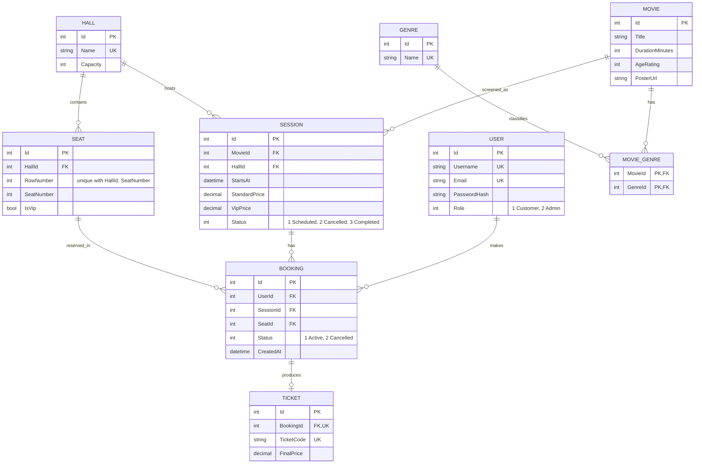

# CinemaGo

ASP.NET Core Web API (.NET 10) for a cinema: movies and showtimes (sessions).
Layered solution: `Domain` (entities, DTOs, exceptions) → `Application` (services) → `Infrastructure` (EF Core / SQL Server) → `Web` (controllers).

## Running

1. Keep the configured SQL Server connection string in `CinemaGo.Web/appsettings.json`. Configure the JWT signing key and SMTP settings through user secrets (do not commit credentials):

   ```powershell
   dotnet user-secrets set "Jwt:Key" "replace-with-a-random-secret-at-least-32-bytes" --project CinemaGo.Web
   dotnet user-secrets set "Email:Smtp:Host" "smtp.example.com" --project CinemaGo.Web
   dotnet user-secrets set "Email:Smtp:Port" "587" --project CinemaGo.Web
   dotnet user-secrets set "Email:Smtp:EnableSsl" "true" --project CinemaGo.Web
   dotnet user-secrets set "Email:Smtp:From" "cinema@example.com" --project CinemaGo.Web
   dotnet user-secrets set "Email:Smtp:Username" "smtp-user" --project CinemaGo.Web
   dotnet user-secrets set "Email:Smtp:Password" "smtp-password" --project CinemaGo.Web
   ```

   `Email:Smtp:Username` and `Email:Smtp:Password` can be omitted for SMTP servers that allow unauthenticated relay. The application uses SMTP over TLS by default and sends one BCC message to all distinct customers affected by a cancellation. Supply `Jwt:Issuer` and `Jwt:Audience` through user secrets or environment variables only if you need to override the configured values.
2. Apply migrations: `dotnet ef database update --project CinemaGo.Infrastructure --startup-project CinemaGo.Web`
3. `dotnet run --project CinemaGo.Web` and open `/swagger`.
4. Tests: `dotnet test`

## API

| Method | Route | Access |
|---|---|---|
| POST | `/api/auth/register`, `/api/auth/login` | anonymous |
| GET | `/api/movies`, `/api/movies/{id}`, `/api/sessions`, `/api/sessions/{id}` | anonymous |
| GET | `/api/movies/sales` | **Admin** (active ticket count and revenue grouped by movie) |
| GET | `/api/genres`, `/api/genres/{id}`, `/api/halls`, `/api/halls/{id}`, `/api/seats` (`?hallId=`), `/api/seats/{id}` | anonymous |
| POST/PUT/DELETE | `/api/movies`, `/api/sessions`, `/api/genres`, `/api/halls`, `/api/seats` | **Admin** |
| POST/DELETE | `/api/movies/{id}/poster` (upload / remove poster image) | **Admin** |
| POST | `/api/sessions/{id}/cancel` | **Admin** |
| POST | `/api/bookings`, `/api/bookings/batch` | JWT (any user) |
| GET | `/api/bookings/my` | JWT (own bookings) |
| GET | `/api/bookings/{id}` | JWT (owner) or **Admin** |
| DELETE | `/api/bookings/{id}` | JWT (owner) or **Admin** |
| GET | `/api/bookings` | **Admin** |
| GET | `/api/tickets/{id}` | JWT (ticket owner) or **Admin** |

Send the JWT as `Authorization: Bearer <token>`. Public registration always creates a `Customer`; the role cannot be supplied by the client. See [Initial Admin](#initial-admin).

## Bookings

All booking endpoints require a valid JWT (`Authorization: Bearer <token>`); anonymous calls return 401.
The user is taken from the token, never from the request body. Another user's booking is reported as 404 (non-admin).

`POST /api/bookings`

```json
{ "sessionId": 1, "seatId": 3 }
```

`201 Created` (with a `Location` header pointing to `/api/bookings/{id}`):

```json
{
  "id": 15,
  "userId": 7,
  "sessionId": 1,
  "seatId": 3,
  "movieTitle": "Dune",
  "sessionStartsAt": "2026-11-01T18:00:00Z",
  "rowNumber": 4,
  "seatNumber": 5,
  "isVip": true,
  "status": "Active",
  "createdAt": "2026-10-28T12:50:00Z",
  "ticketCode": "3f9c2a7e5b1d4c0f8a6e2d9b7c4a1e50",
  "finalPrice": 20.00
}
```

The price is calculated on the server (`vipPrice` for VIP seats, otherwise `standardPrice`).

| Status | Reason |
|---|---|
| 400 | seat is in another hall, or the session is cancelled / already started, or the booking is already cancelled |
| 403 | cancelling another user's booking |
| 404 | session, seat or booking not found |
| 409 | seat already booked for this session |

`POST /api/bookings/batch` accepts `{ "sessionId": 1, "seatIds": [3, 4] }` and creates all requested bookings and tickets in a single serializable transaction (1–20 unique seats). If any seat is invalid or unavailable, none of the batch is saved.

`DELETE /api/bookings/{id}` cancels the booking (204) and frees the seat for a new booking.
Double booking is prevented both by a service check and by a unique database index on active
`(SessionId, SeatId)`, which also protects against simultaneous requests.

## Tickets

`GET /api/tickets/{id}` returns the details of a ticket (the `ticketCode`/`finalPrice` are also in the booking response).
A customer can only read tickets of their own bookings (ownership is checked via the related booking); an Admin can read any ticket.

```json
{
  "id": 5,
  "bookingId": 15,
  "ticketCode": "3f9c2a7e5b1d4c0f8a6e2d9b7c4a1e50",
  "finalPrice": 20.00,
  "movieTitle": "Dune",
  "sessionStartsAt": "2026-11-01T18:00:00Z",
  "hallName": "Hall 1",
  "rowNumber": 4,
  "seatNumber": 5,
  "isVip": true
}
```

| Status | Reason |
|---|---|
| 200 | ticket found |
| 401 | no / invalid JWT |
| 403 | ticket belongs to another user (non-admin) |
| 404 | ticket not found |

## Genres, halls and seats

All write operations require **Admin**; request bodies are validated (FluentValidation) and return 400 on invalid input.

| Resource | Create / Update body | Business rules |
|---|---|---|
| `/api/genres` | `{ "name": "Drama" }` | name unique (case-insensitive, 409); a genre assigned to movies cannot be deleted (409) |
| `/api/halls` | `{ "name": "Hall 1", "capacity": 40 }` | name unique (409); capacity cannot drop below the existing seat count (409); a hall with sessions or seats cannot be deleted (409) |
| `/api/seats` | create `{ "hallId": 1, "rowNumber": 1, "seatNumber": 1, "isVip": false }`, update without `hallId` | hall must exist (404); row/seat unique per hall (409); hall cannot exceed its capacity (409); row/seat position cannot change after any booking (409); a seat with bookings cannot be deleted (409) |

Missing resources return 404 on get/update/delete.

## Movie genres

`POST /api/movies` and `PUT /api/movies/{id}` accept `genreIds`:

```json
{ "title": "Dune", "durationMinutes": 155, "ageRating": 12, "genreIds": [1, 5] }
```

- Unknown genre ids → 400 (nothing is saved); duplicates are ignored.
- `PUT` **replaces** the genre set (`[]` or omitted removes all genres).
- `posterUrl` (optional, max 500 chars) is an `http(s)` URL or a site-relative path such as `/uploads/posters/<file>`; see [Movie posters](#movie-posters).
- Movie responses include `"genres": [{ "id": 5, "name": "Sci-Fi" }]`; `GET /api/movies?genreId=` filters by genre.

## Movie posters

`POST /api/movies/{id}/poster` (**Admin**, `multipart/form-data` with a `file` field) stores a poster image and sets the movie's `posterUrl` to `/uploads/posters/<random>.<ext>`; `DELETE /api/movies/{id}/poster` removes it.

- Only JPEG, PNG and WebP are accepted, up to 5 MB. The type is detected from the file's content, not its name or declared content type (400 otherwise); 404 for an unknown movie.
- Files are saved under `CinemaGo.Web/App_Data/uploads` (git-ignored; override with `Uploads:Path`) and served as static files at `/uploads/...`. Uploading a new poster deletes the previous uploaded file.
- Instead of uploading, `posterUrl` can also be set to an external image link through `POST/PUT /api/movies`.

## Session cancellation

`POST /api/sessions/{id}/cancel` (**Admin**) sets the session to `Cancelled` and cancels all of its `Active` bookings in one
serializable transaction, so the seats become available again and no new bookings are accepted. After commit, the configured SMTP server sends a cancellation email to all distinct affected customers. SMTP configuration is required when the session has active bookings; if delivery fails, the API reports 503 (the cancellation itself has already committed). 404 if the session is unknown,
409 if it is already cancelled, 400 if it is completed. (Tickets are kept for history.)

## Sales aggregate demo

`GET /api/movies/sales` (**Admin**) groups active booking tickets by movie, calculates ticket count and `SUM(FinalPrice)`, then sorts by revenue descending. Cancelled bookings are excluded. This SQL-translated LINQ query is a sample aggregate for the project defense.

## Seed data

Seeding is idempotent
and runs at startup when `Seed:Enabled` is `true` (enabled in `appsettings.Development.json`). Startup then also applies pending migrations.
It creates 7 genres, 5 movies with genres and poster links, 3 halls (`Hall 1` 5×8, `Hall 2` 6×10, `Hall 3` 4×6 seats, last row VIP; capacity = seat count).

When `Seed:DemoData` is also `true` (enabled in `appsettings.Development.json`), a one-time set of test data is added for manual testing: an admin (`demo_admin`) and customers `alice`, `bob`, `carol`, `dave` (password `Passw0rd!Demo1`, emails `<name>@cinemago.test`), 9 sessions (2 completed, 6 scheduled, 1 cancelled), and 8 bookings per session with tickets for the active ones (some cancelled). It is skipped if `demo.admin@cinemago.test` already exists. Do not enable it in production.

## Initial Admin

There is no way to register as Admin through the API. The first Admin is created at startup from configuration, only when **no Admin exists yet**
and an `InitialAdmin:Password` is supplied. Keep the credentials out of source control (user secrets or environment variables):

```
dotnet user-secrets set "InitialAdmin:Username" "admin" --project CinemaGo.Web
dotnet user-secrets set "InitialAdmin:Email" "admin@example.com" --project CinemaGo.Web
dotnet user-secrets set "InitialAdmin:Password" "a-long-random-password" --project CinemaGo.Web
```

(or `InitialAdmin__Username` / `InitialAdmin__Email` / `InitialAdmin__Password` environment variables). The password needs at least 12 characters and is stored hashed.
Once an Admin exists the settings are ignored (remove them afterwards); an existing non-admin account is never promoted automatically.

## Concurrency

- **Bookings:** a unique filtered index on `Bookings(SessionId, SeatId) WHERE Status = Active` guarantees one active booking per seat; a lost race surfaces as 409.
- **Seats and halls:** adding seats and changing hall capacity run in a **Serializable** transaction, preventing concurrent requests from exceeding the hall's capacity.
- **Sessions:** create/update (hall overlap check) and cancel run in a **Serializable** transaction (`IUnitOfWork.ExecuteInSerializableTransactionAsync`),
  so two simultaneous requests cannot both pass the overlap check.
- **SQL Server verification:** `SessionConcurrencySqlServerTests` tests parallel capacity/booking requests and applies EF migrations to a fresh temporary database. Set `CINEMAGO_TEST_SQL` to use a specific SQL Server connection; otherwise tests target LocalDB and report skipped when it is unavailable.

## Database ER diagram



## Behavior notes

- Errors are mapped centrally (`GlobalExceptionHandler`) to RFC-style `application/problem+json` ProblemDetails:
  `ConflictException`→409, `ForbiddenException`→403, with validation errors in the `errors` extension.
- Request DTOs are validated with FluentValidation (`RequestValidators.cs`); invalid models return 400 automatically.
- Session cancellation emails are sent as HTML (styled like the frontend's dark/gold theme, templates in `EmailTemplates.cs`) with a plain-text alternative.
- Session start times are UTC: values must carry a `Z`/offset and be in the future.


